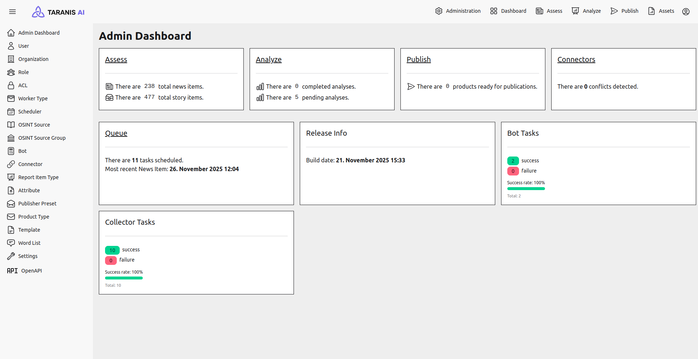

> [!NOTE]
> These options are accessible only via users with respective administration privileges. (See [User management](user-management.md))

See [Admin Dashboard](../dashboard/administration.md) for workflow statistics, queue navigation, release information, system health, and task outcomes.

See [Backup / Restore](backup-restore.md) for backing up and recovering Docker Compose and Kubernetes deployments.

## Screenshots

Administration dashboard showing statistics and all its functionalities (sidebar)

