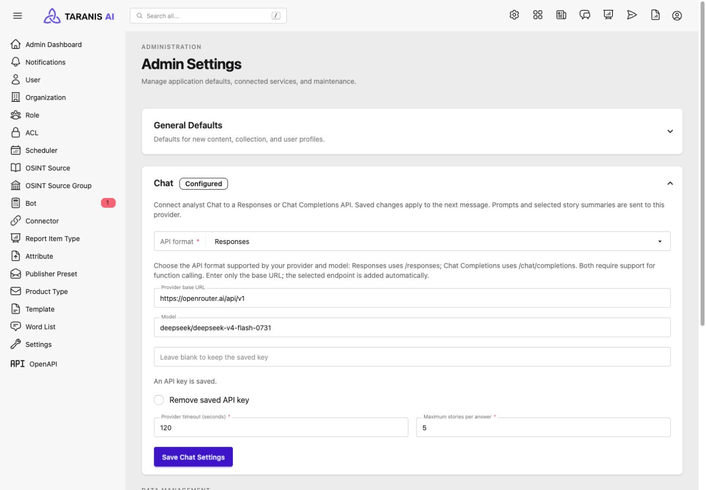

[Chat](../chat/_index.md) uses a provider configured in **Administration > Settings > Chat**. This section appears only when Chat is enabled in the deployment. See [Chat deployment](../getting-started/09_chat.md) to enable it first.

## Configure the provider

Expand **Chat**, enter the connection settings, and select **Save Chat Settings**. Saved changes apply to the next message without restarting the application.

| Setting | What to enter |
| --- | --- |
| **API format** | **Responses** (the default) or **Chat Completions**, matching the provider and model. Both require function calling. |
| **Provider base URL** | The provider's API base URL, for example `https://provider.example/v1`. Omit `/responses` and `/chat/completions`; Taranis appends the endpoint for the selected format. |
| **Model** | The model identifier expected by the provider. Leave blank only if the provider supplies a default. |
| **API key** | A key for the configured provider, or blank for a provider that requires no authentication. |
| **Provider timeout (seconds)** | Timeout for provider response reads. Default: `120`; minimum: `1`. This is separate from the overall turn deadline. |
| **Maximum stories per answer** | Maximum number of Story summaries supplied for an answer. Default: `5`; allowed range: `1–20`. This does not limit the total matching count or the results available in Assess. |

Existing settings retain **Responses** unless an administrator changes the API format. The **Configured** badge indicates that a base URL is saved; verify the connection by sending a message in Chat.

The API key field never displays a saved key. **Leave it blank to keep the existing key**. To remove it, select **Remove saved API key** and save. Updating other fields does not require re-entering the key.

Chat has its own provider configuration. The deployment variables used by [LLM Bot Service](../getting-started/08_llm-bot.md) do not configure Chat.

## Verify setup

1. Open **Chat** and confirm that the setup warning is gone.
2. Ask a general question to check that the provider returns an answer.
3. Ask for Stories on a topic present in your collection. Confirm that the answer includes **View N matching stories in Assess**, and open that link to check the filters and results.
4. Reopen the conversation from the history sidebar to check persistence.

If a request fails, check that the selected API format and model support function calling, that core can reach the base URL, and that the credentials are valid. See [Chat troubleshooting](../chat/_index.md#if-a-message-fails) for user-visible errors and [deployment requirements](../getting-started/09_chat.md#runtime-and-proxy-requirements) for Redis and timeout checks.

## Privacy and storage

Core sends the provider the current prompt, up to the latest 10 saved messages, the analyst-visible filter catalog, and accessible references to recent results. For search answers, it also sends up to the configured number of bounded Story summaries, including Story IDs, titles, and creation times. Searches enforce the analyst's source ACL and TLP restrictions.

Choose a provider and transport appropriate for this data. Responses requests set `store: false`; Chat Completions requests omit that option. The provider may still apply its own retention or abuse-monitoring policy.

Taranis stores conversations and answers in its database until the owner deletes them. Search metadata stores filters, the total count, and selected Story IDs; it does not store a separate copy of raw News Item content. Generated answers can themselves contain Story information.

Provider API keys are stored in the application database and omitted from serialized settings responses. Protect database access and backups. Disabling Chat preserves conversation history; it does not delete it.
