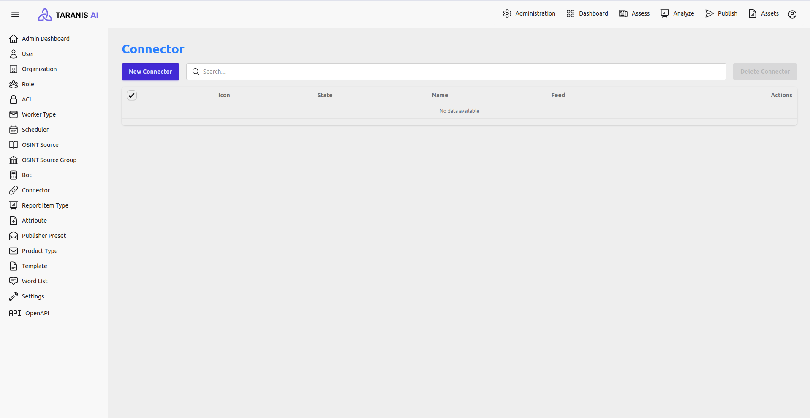
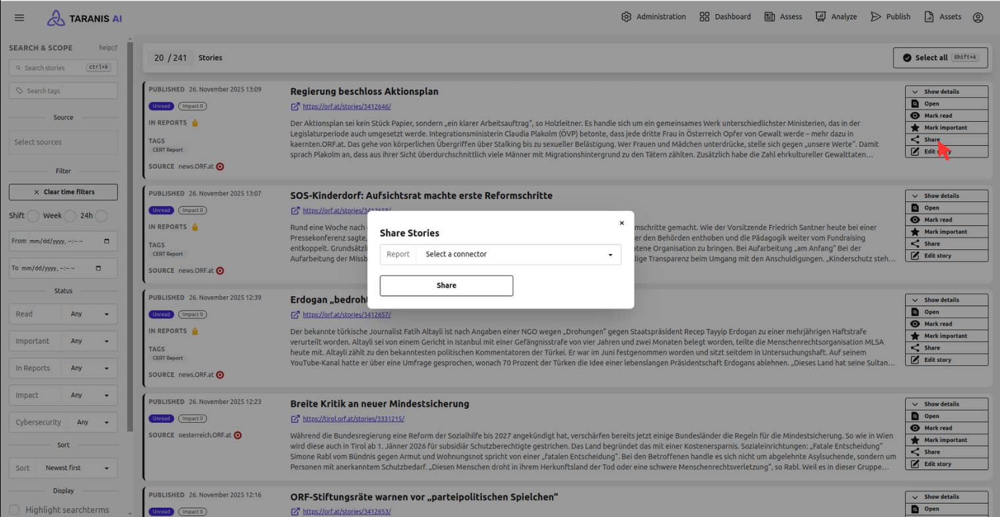

Supported options:

- [MISP Connector](https://github.com/taranis-ai/taranis-ai/blob/master/src/worker/worker/connectors/misp_connector.py)
  - [Usage of the MISP Connector](#usage-of-the-misp-connector)

## MISP Connector

*The MISP connector is currently in an experimental stage. Please submit issues when you discover any problems or need support with its usage.*

> Until the [definitions of our MISP Objects](https://github.com/taranis-ai/taranis-ai/tree/master/src/worker/worker/connectors/definitions/objects) are not officially part of the MISP platform, feel free to import them manually (see [MISP Objects](https://www.misp-project.org/2021/03/17/MISP-Objects-101.html/)). This enables you to edit the objects of News Items and Story data directly in you MISP instances without Taranis AI.

MISP Connector enables Taranis AI to push Stories to [MISP](https://www.misp-project.org/) in the representation of MISP Events.

The created events contain automatically an [Event Report](https://www.circl.lu/doc/misp/create-event-report/) based on the Story content (currently it encompasses the Story description and Story summary, if you feel the Event Report would benefit extending with more information, please open a feature request for it [here](https://github.com/taranis-ai/taranis-ai/issues)).

First the user with administrative privileges needs to make sure, the permissions connected to Connectors usage are assigned appropriately, by default, they are not assigned to any user, not even the admins themselves. Then the Connector needs to be setup in the Admin section under the Connectors tab.

Explanation of individual permissions:

- Connector user access - ability to share a story to a Connector
- Config connector access - ability to access admin Connector configuration
- Config connector create - ability to create a Connector
- Config connector delete - ability to delete a Connector
- Config connector update - ability to update a Connector configuration



- Required parameters:
  - URL: Base URL to the MISP instance (e.g. ```https://localhost```)
  - API_KEY: API key to access the instance (see [MISP Automation API](https://www.circl.lu/doc/misp/automation/#automation-api))
  - ORGANISATION_ID: ID of your organisation, usually starts with ID=1 (*It is very important that this value is correct, otherwise the tool will not work properly!*)

- Optional parameters:
  - SSL_CHECK: if enabled, the SSL certificate will be validated
  - SHARING_GROUP_ID: set to the ID of a sharing group, if you want to collect only one sharing group (see [Create and manage Sharing Groups](https://www.circl.lu/doc/misp/using-the-system/#create-and-manage-sharing-groups))
  - DISTRIBUTION: Integer value of the distribution of the created events (see [Setting distribution](https://www.circl.lu/doc/misp/best-practices/#setting-distribution) and [Creating an event](https://www.circl.lu/doc/misp/using-the-system/#creating-an-event))
  - REQUEST_TIMEOUT
  - USER_AGENT
  - PROXY_SERVER
  - ADDITIONAL_HEADERS
  - REFRESH_INTERVAL

  ### Usage of the MISP Connector

  To send a story to MISP, use the button "Share to Connector" in Story options in Assess. When an update to the Story is later on made, it is recommended to share the change immediately, you need to do this manually like the first time.

  > Before a Story is pushed repeatedly to update the MISP event, it is important to check if any proposals are pending in the MISP event, as it would override the original content of it and would make it difficult to resolve the proposals correctly.

  

  When a Story is collected, that is not owned by your configured organisation, it is possible to update it in Taranis AI and by using the same "Share to Connector" button in the Story options a proposal to the event is created. Then the owning organisation should review this proposal, and approve or reject the changes.
