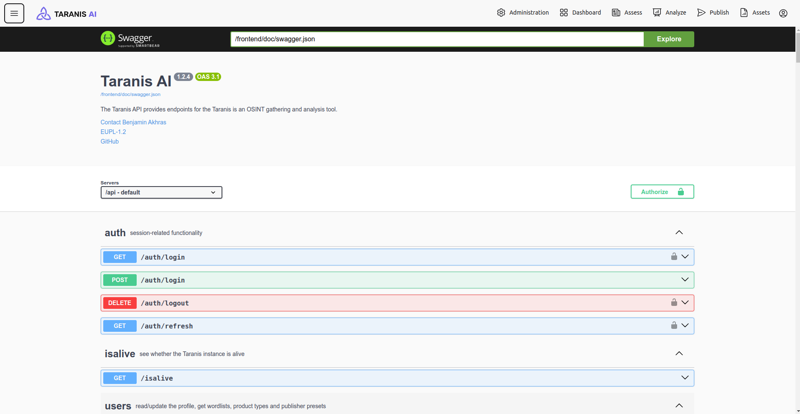

## Description

The admin user can access the Taranis API through Swagger UI. Swagger UI displays OpenAPI specifications as an interactive API documentation.
Current OpenAPI specifications are available at [https://github.com/taranis-ai/taranis-ai/blob/master/src/core/core/static/openapi3_1.yaml](https://github.com/taranis-ai/taranis-ai/blob/master/src/core/core/static/openapi3_1.yaml)

## Functionalities 👤

see: [Swagger UI](https://swagger.io/tools/swagger-ui/)

## Screenshots

Taranis instance is alive

