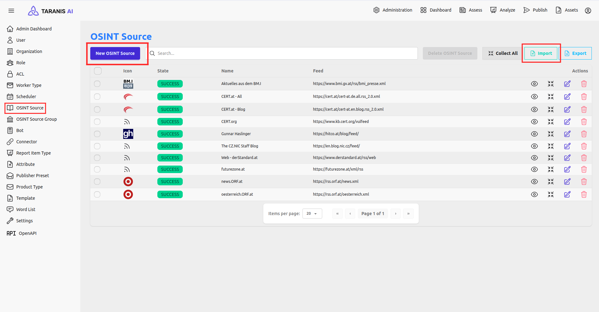
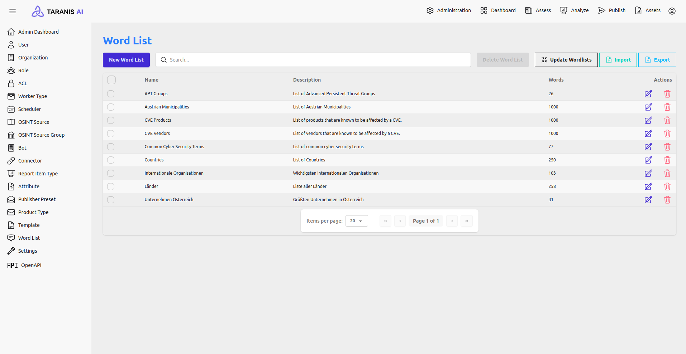
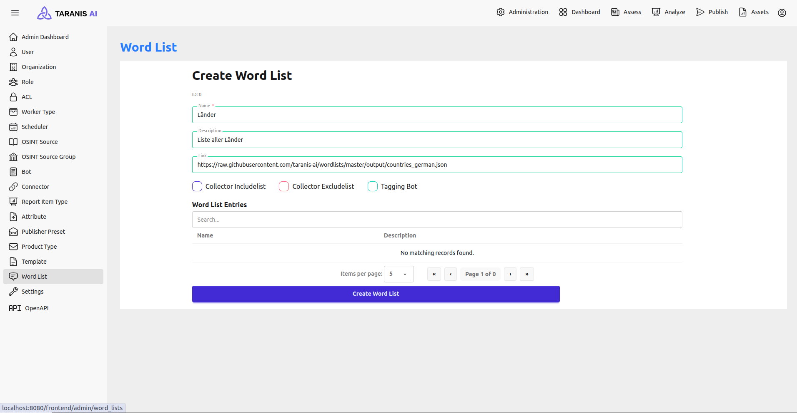
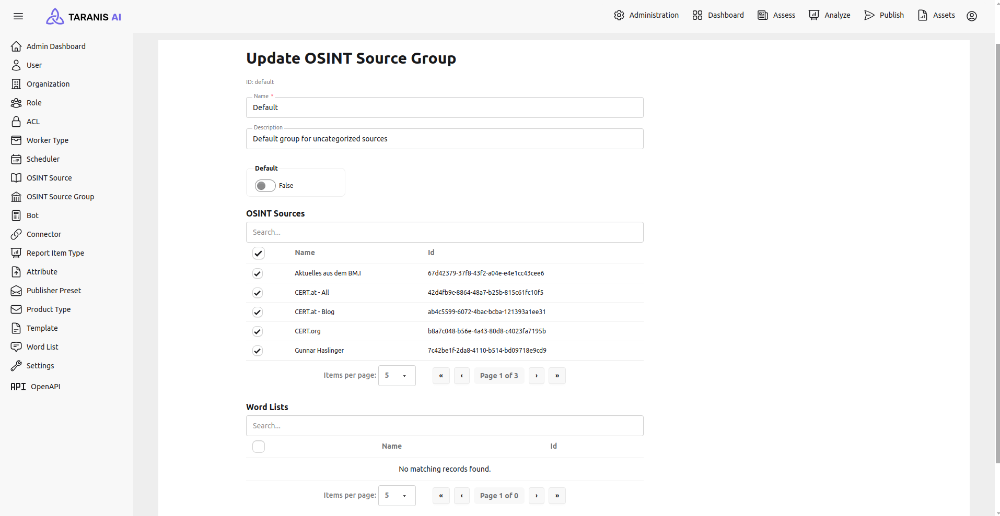
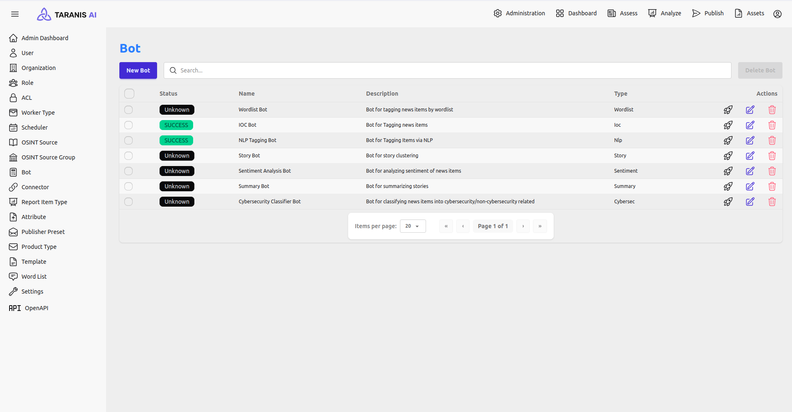
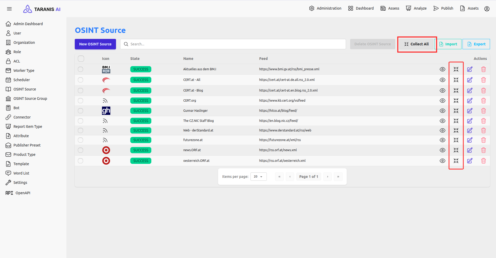

## Functionalities

1. [Create OSINT Sources](#1-create-osint-sources)
1. [Add word lists](#2-add-word-lists)
1. [Adapt word list's functionality](#3-adapt-word-lists-functionality)
1. [Enable include/exclude list filtering](#4-enable-includeexclude-list-filtering)
1. [Bot selection](#5-bot-selection)
1. [Collect Sources](#6-collect-sources)

## 1. Create OSINT Sources

- Import/Export: Sources can be imported and exported as JSON
- CRUD: Sources can be created, updated and deleted. For each source a collector, feed URL and the content location can be defined among other things.

> [!NOTE]
> To get started there is list of RSS sources we worked with: [Initial setup](../getting-started/01_deployment.md#initial-setup)

## 2. Add word lists

- Import/Export: Word lists can be imported and exported as json
- CRUD: Word lists can be created, updated and deleted.

## 3. Adapt word list's functionality

Word lists can have the following functionalities (displayed under "usage"):

- Collector Includelist: Collected news items using words of this word list will be accepted
- Collector Excludelist: Collected news items using words of this word list will not be accepted
- Tagging Bot: Collected news items will be tagged with words from these word lists
- Collector Includelist & Tagging Bot: A word list can be used for tagging and include listing

## 4. Enable include/exclude list filtering

To activate include or exclude lists, they need to be added to the default source group.

It has to be mentioned, that this include/exclude filtering happens during the news item collection. Therefore, only filtered news items will be stored in the database and displayed in "Assess".

## 5. Bot selection

After the collection, it is possible to adapt news items.

Common bots include:

- Wordlist Bot: Tags News Items by wordlist.
- IOC Bot: Finds indicators of compromise in News Items.
- NLP Bot: Tags News Items via named entity recognition.
- Story Clustering Bot: Groups related Stories.
- Summary Bot: Summarizes Stories and can generate Story titles.
- Sentiment Analysis Bot: Adds sentiment attributes to News Items.
- Cybersecurity Classifier Bot: Classifies whether content is cybersecurity related.

CRUD: Bots can be created, updated and deleted.

Index: Decides the order of bots

RUN_AFTER_COLLECTOR: Indicates if bot is active after collection

LLM-backed bots can use the optional [LLM Bot Service](../getting-started/08_llm-bot.md). Full bot configuration is documented in [Bots](bots.md).

The optional IntelOwl Bot enriches indicators extracted by the IOC Bot. Configure IntelOwl and keep the IOC Bot before it in the run order; see [IntelOwl enrichment](intelowl.md).

## 6. Collect Sources

After all settings are made, sources can be collected.
Either collect all sources by clicking on the "collect sources" button, or collect single sources.

