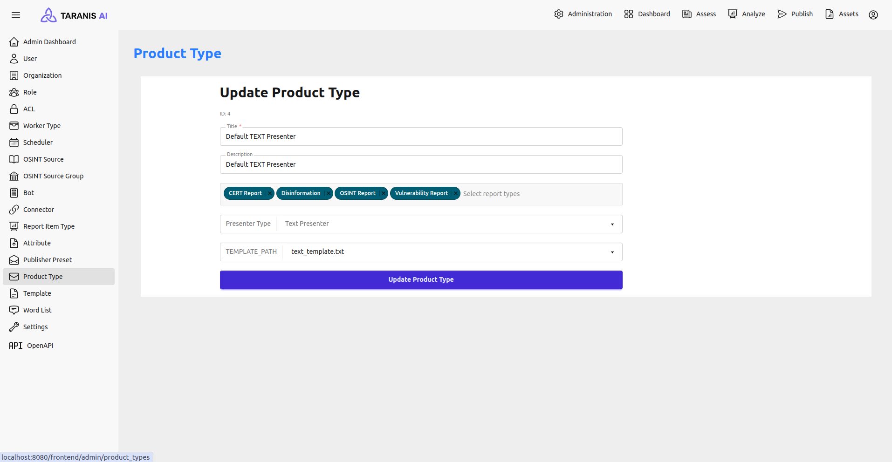

## Prebuilt Product Types
- CERT Daily Report
- Default HTML Presenter
- Default MISP Presenter
- Default PDF Presenter
- Default TEXT Presenter

## Editing Product Types

All crucial fields are editable, with the most important being Type, Template, and Report Types.

- Type: It's the responsibility of the administrator to ensure the selected type is compatible with the subsequently provided template.
- Template: Users can select from prebuilt templates or add new ones.
- Report Types: This field determines which types of reports can be added to the products.

Template paths are validated before use. A Product Type cannot render a Report Type unless that Report Type is associated with the Product Type.



## Create new Product Types

> [!NOTE]
>     While there are several prebuilt product types available, users also have the option to create their own product types using custom templates.

It can be beneficial to create custom Product Types to meet desired results with the publishers.

### Example of creating a simple new template using Jinja2
This is an example to render arbitrary values and loop over attributes.
1. Create a new file with a unique name in `src/core/core/static/presenter_templates`.
2. Write a custom template:
    ```python
    TITLE: {{ data.report_items[0].get('title') | default('No title provided', true) }}<br>
    DATE CREATED: {{ data.report_items[0].get('created') | default('Not available', true) }}<br>
    LAST UPDATED: {{ data.report_items[0].get('last_updated') | default('Not available', true) }}<br>
    
    {{ name }}: {{ attribute }}<br>
    
    ```

> [!NOTE]
> If one is interested in creating own templates, it is a good to start to render the object `{{ data }}` first, to understand how to parse the object properly.

3. Select the new template in the Product Type.
4. Render a test Product before using the Product Type in production.

> [!NOTE]
> It is also possible to copy `src/core/core/static/presenter_templates/<new-custom-template.txt>` to a dynamic folder `src/core/taranis_data/presenter_templates` so a restart is not necessary.


## Advanced behaviour
If needed, templates can be utilized for more complex renderings by leveraging custom attributes.

Currently, this functionality is demonstrated in the `text_template.txt` file, where the attribute `omission` of type "Omit Keys" allows for the exclusion of unnecessary attributes from publication. To employ this feature, the administrator simply needs to add this attribute to the relevant report type. Then, within a specific report ([Analyze View](../analyze/_index.md)), they can specify the attributes to omit by listing them as comma-separated strings.

It is essential to ensure that the "Name" used for the report type attribute matches exactly with the key used in the template.
