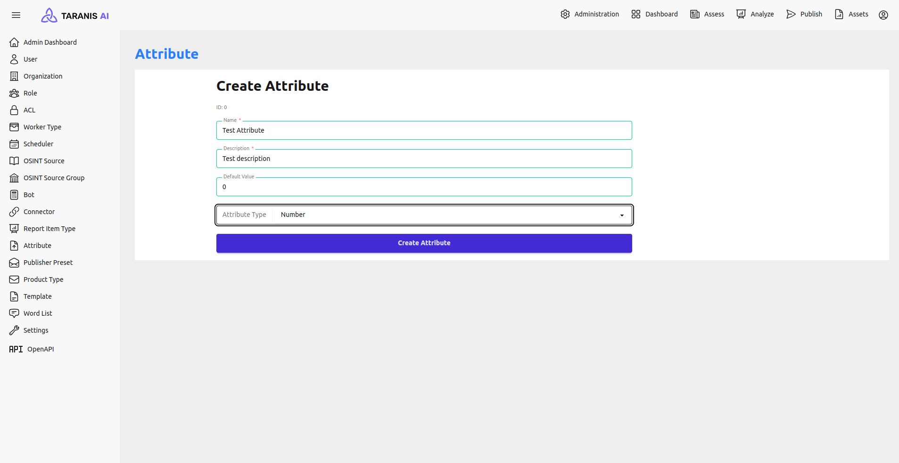
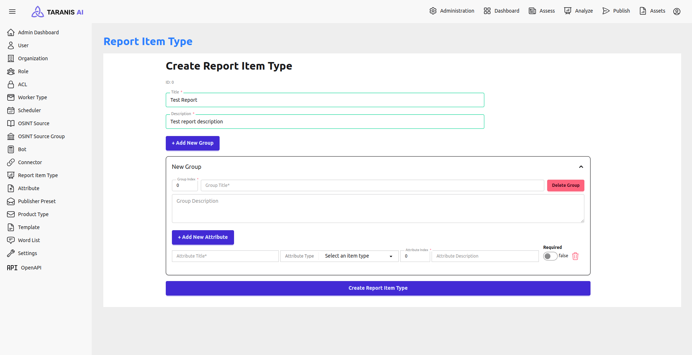
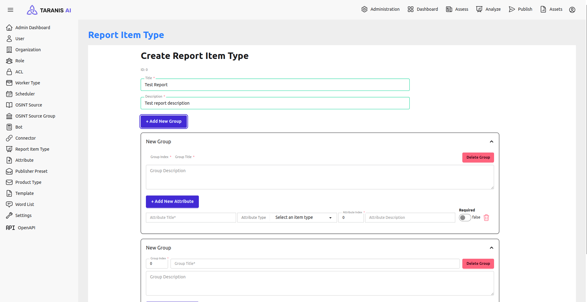
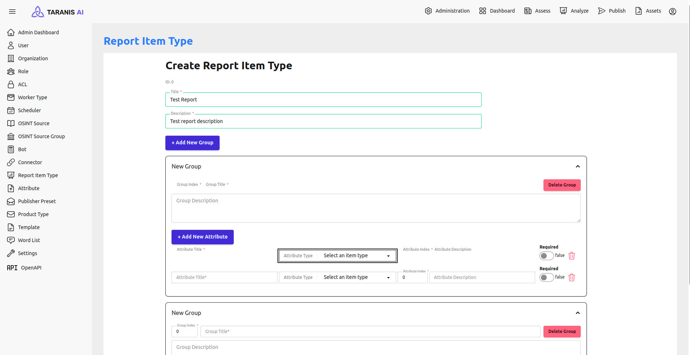

> [!NOTE]
> When creating new Reports, one of the created report types have to be selected (see [Analyze](../analyze/_index.md)).

### Attributes
Desired attributes need to be created first. Then they can be managed by the admin user. Besides name, description and default value also type, validator and validator parameter can be set.

### Report Types - CRUD
* Create: Report types can be created ("New item"). After adding a new attribute group, different attributes can be added to this group.
* Read & Update: Report types (including their attribute groups) can be updated by clicking on them in the list. Their update will not affect Reports, which already use the Report Type
* Delete: One or multiple reports can be deleted at once.

## Screenshots
Add new Attribute

Report Types -  Create new Report Type

Report Types - Add new Attribute Group

Report Types - Select new Attribute from list

