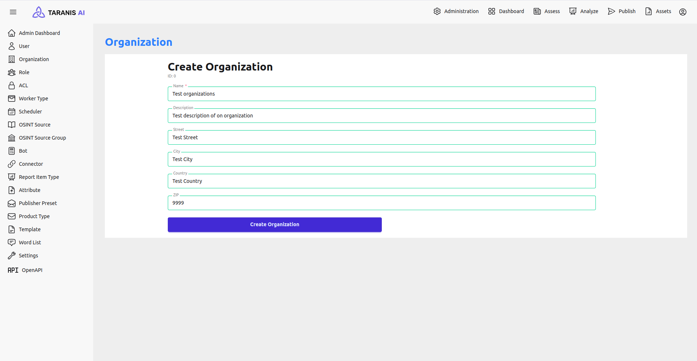
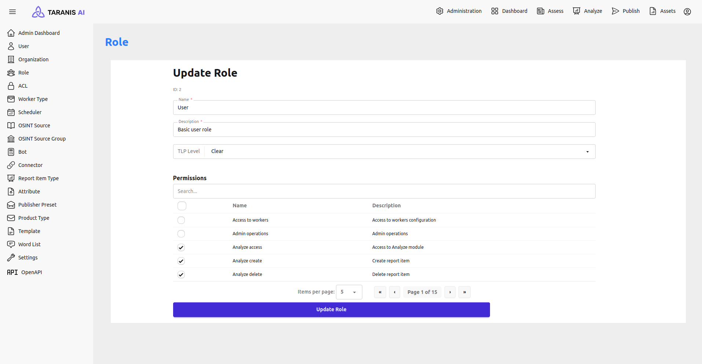
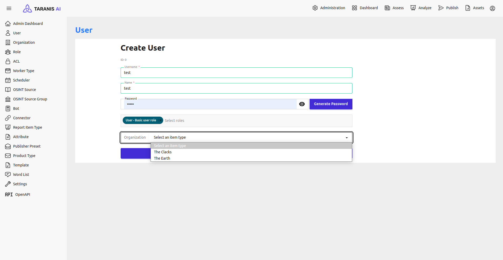

### Organizations

Organizations can be added with following parameters defining them: name, description, address.

### Roles

Define roles with permissions. Roles are then assigned to users to control access to administration, Assess, Analyze, Publish, connector, and worker features.

Access-control lists (ACLs) restrict user-facing content and reference data. A user can be granted access to a source directly or through an ACL on one of its source groups; a source-group wildcard grants access to all sources, including ungrouped sources. `ADMIN_OPERATIONS` bypasses these ACL checks, but does not bypass TLP restrictions. Administration and configuration access is controlled by the relevant `CONFIG_*` permissions.

### Users

Manage users and assign them roles and an organization.

The user table supports JSON import and export:

- **Export** downloads `users_export.json`. If users are selected, only those users are exported; otherwise all users are exported.
- The export format is `version: 1` with a `data` list containing user names and usernames.
- Passwords are never exported.
- **Import** accepts the exported JSON format, then assigns the selected organization and selected roles to every imported user.
- Existing usernames are skipped and reported in a warning instead of failing the whole import.
- Imported users without a password stay passwordless. Use this for externally authenticated users, or set a local password afterwards.

### Operational CLI

Operators can repair existing database-auth users from inside the core container with `taranis-cli`.

Reset an existing user's password:

```bash
docker exec -it core taranis-cli set-password admin
kubectl exec -it deploy/core -- taranis-cli set-password admin
```

For non-interactive automation, pass the password through standard input:

```bash
printf '%s\n' 'new-password' | docker exec -i core taranis-cli set-password admin --password-stdin
```

Replace an existing user's complete role list:

```bash
docker exec -it core taranis-cli set-roles user Admin
kubectl exec -it deploy/core -- taranis-cli set-roles user Admin User
```

`set-roles` accepts exact role names or role IDs. It replaces the full role list; include every role the user should keep. Prefer the password prompt or `--password-stdin` so passwords do not land in shell history.

## Screenshots

Add new Organization



Edit basic user role



Add new User


