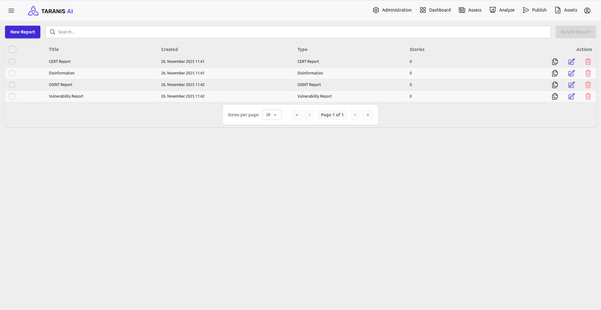
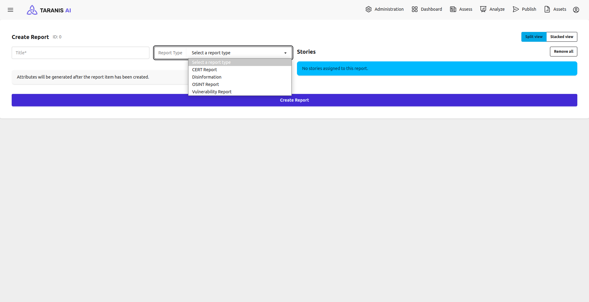
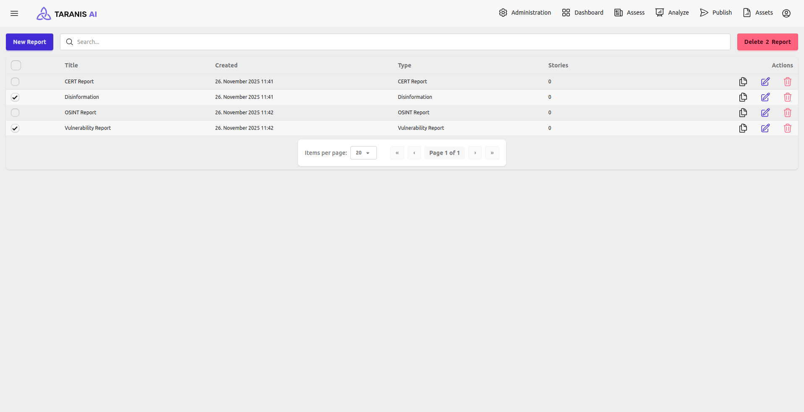
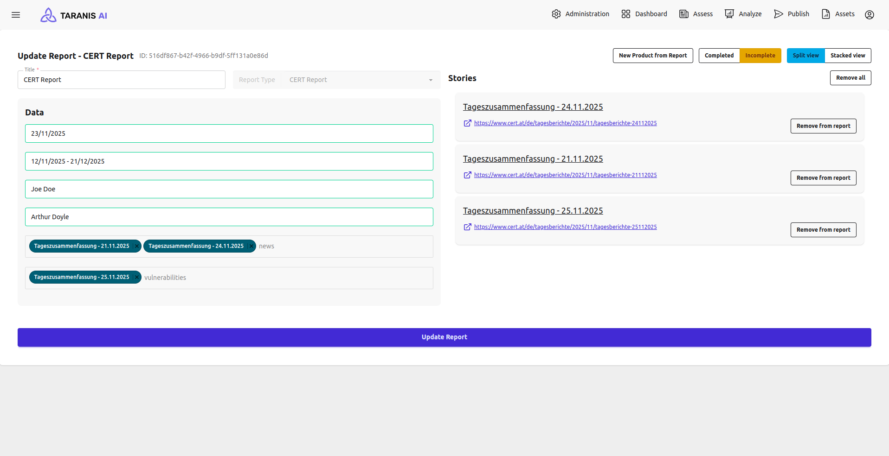

* [Description](#description)
* [Functionalities](#functionalities)
* [Screenshots](#screenshots)

## Description

Analyze is where analysts create and maintain Reports. Report fields are defined by administrator-managed [Report Types](../admin/report-types.md), and Reports can collect Stories from Assess before they are rendered into Products.

## Functionalities
### CRUD

* Create: Reports can be created for any available Report Type.
* Read & Update: Reports can be opened, edited, completed, and connected to Stories from Assess.
* Clone: Existing Reports can be cloned when a new report should start from the same structure.
* Delete: One or multiple Reports can be deleted at once.

> [!NOTE]
> Reports can be set to **Completed** or **Incomplete** from the report edit view. Products that include incomplete Reports show a warning before manual publishing.

### Report editor

The report editor supports split and stacked layouts. The Report Type is selected when the Report is created; after creation, its configured attributes are shown in the editor.

Reports can contain multiple Stories. Stories added from Assess appear in the report editor and can be removed before the report is rendered.

### Product handoff

Use **Publish** in the report editor to open an existing Product or create a new Product prefilled with the current Report. Product rendering and external delivery happen in [Publish](../publish/_index.md).

### Version history

Reports keep a revision history. Use **Version History** from the report editor to inspect saved revisions and compare adjacent revisions. Revision diffs are for audit and troubleshooting; they do not currently provide rollback.

### Filter

* Search: Items can be filtered by string search
* Display: Number of items displayed per page
* Offset: Number that defines first item displayed
* Filter: Filter time range (creation date)
* Completed/Incomplete: Filter by report status
* Report Type: Filter by Report Type

## Screenshots
Incomplete reports created today

Add new report item

Deleting multiple reports at once

Report item view

