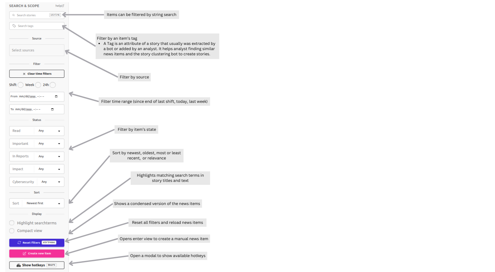
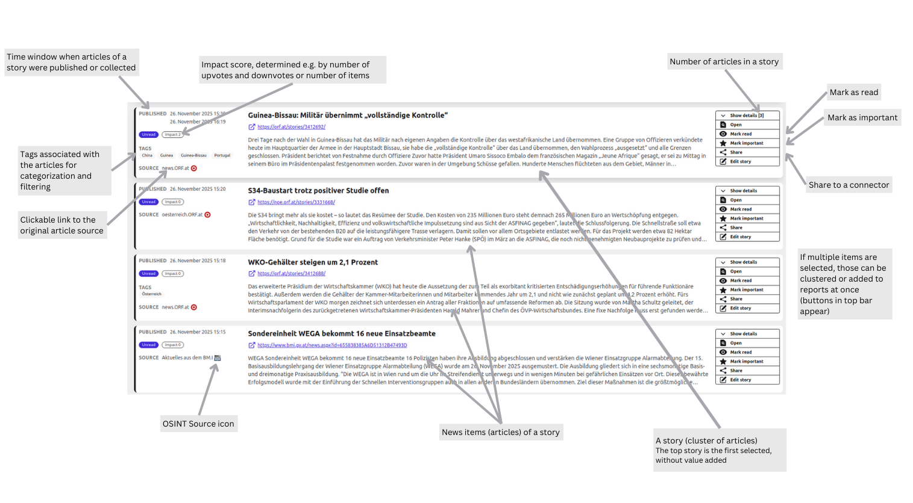

* [Description](#description)
* [Functionalities](#functionalities)


## Description

Assess is the analyst queue for collected Stories and News Items. It supports search, filtering, sorting, merging, bookmarks, report assignment, connector sharing, and review state changes.

## Functionalities

### Search

Use the Assess sidebar search for Story text search inside the current Assess view. Use the global [Omnisearch](../search/_index.md) field to search across Stories, Reports, and Products, or to open Assess with filter tokens such as:

```text
story: source:"CERT.at" tag:ransomware read:false range:last7
```

For natural-language questions and summaries, use [Chat](../chat/_index.md) when enabled. Search answers link back to Assess with the generated filters applied.

### Filters



##### Details:

- **First Day**: The Story's creation date, typically matching the oldest News Item's "published date."
- **Last Day**: The Story's update date, usually reflecting the latest addition or change.

For **manually created stories**, the "updated" timestamp is essentially the creation time. As a result, filtering by **Last day** for a manually created story will not return it, even if an older "published date" is set.

Assess filters include search text, source, source group, tag, language, read state, important state, report membership, relevance, cybersecurity classification, changed-by actor, date range, and sort order.

Users can save the current Assess filters from the **Saved filters** button. A saved filter can be marked as the default for the user profile. Dashboard shortcuts show saved Assess filters so frequently used queues can be opened directly. See [Filter Lists and Saved Filters](filter-lists.md).

### Items

News items collected by [Collectors](../admin/collectors/_index.md) become visible in Assess. They can be grouped into Stories automatically by [Bots](../admin/bots.md) or manually by analysts.



Detail view:
* Relevance of item/aggregate can be changed with "up/down" buttons

Charts:
* Each item displays a chart if data has been aggregated in the last 7 days.
* Line and bar chart display the same data, which is the accumulation of items per day.
* The y-axis of the line chart can be adapted and is the same for all charts in the current items list. Therefore, charts can be compared properly.

Story actions include marking read/unread, marking important, sharing to connectors, ungrouping, version history, deleting, editing, adding to reports, and bookmarking. Bulk actions are available after selecting stories; visible shortcuts include `Shift+R` for adding to a report and `Shift+B` for bookmarking.

### Story import and export

Use **Share → Export to JSON** to transfer an individual Story or a selection of Stories. Import either an Assess or Admin export through **Create manual news item → Create from file** or **Admin → Settings → Import Stories**. Both import screens accept complete Stories, including exports with metadata.

Stories are the primary transfer format. Existing standalone News Item JSON can also be imported; each item receives a new parent Story. Transfers do not restore all instance state and do not merge or overwrite existing content. See [Story import and export](story-transfers.md) for formats, permissions, and limitations.

### Version history

Stories keep a revision history. Use **Version History** from the Story actions menu to inspect saved revisions and compare the changes between adjacent revisions. Revision diffs are intended for audit and troubleshooting; they do not currently provide rollback.

### Bookmarks

Bookmark collections are private per user. A story can be bookmarked from its action menu, or selected stories can be added to an existing or new collection from the Assess toolbar. If a user bookmarks a single story before creating any collections, Taranis AI creates a default collection named `Bookmarks`.

The Assess page shows up to six bookmark collections in a compact bar. Use **All bookmarks** to open the full bookmark page, rename or delete collections, reorder them, and remove stories from a collection. Removing a story from a bookmark collection does not delete the story from Assess. See [Bookmarks](bookmarks.md).

### Story Edit Advanced View

The Story Edit view can expose AI assisted actions when advanced story options are enabled in user settings. Available actions include generating a summary and title, and running sentiment analysis. When sentiment attributes are present, the advanced view shows the story sentiment status.
