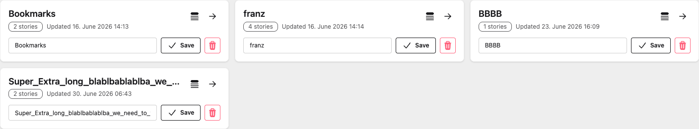

Bookmarks let each user keep private collections of Stories without changing the Stories themselves. They are useful for follow-up queues, handovers, and temporary research sets.

## From Assess

Use the Story action menu to bookmark one Story. If the user has no bookmark collections yet, Taranis AI creates a default collection named `Bookmarks`.

For bulk work, select Stories in Assess and use **Bookmark** in the toolbar. The dialog can add selected Stories to an existing collection or create a new collection.

The Assess list shows up to six bookmark collections in the bookmark bar. Use **All bookmarks** to open the full bookmarks page.

## Bookmarks page

The bookmarks page supports:

- Creating a new collection.
- Opening a collection.
- Renaming a collection.
- Dragging collections to reorder them.
- Deleting a collection.

Deleting a bookmark collection only removes the collection. It does not delete the Stories from Assess.

Inside a collection, select Stories and use **Remove selected** to remove them from that collection. Story access still follows the user's normal permissions and TLP visibility.
