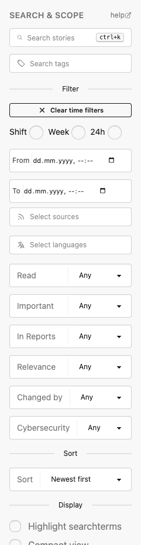
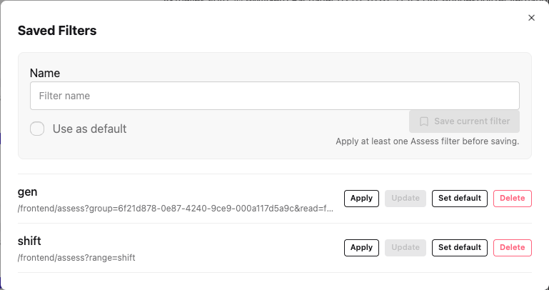

Assess filter lists are the dynamic option lists behind the sidebar filters. They are built from the current data in Taranis AI and include Sources, Source Groups, Tags, and Languages.

Filter lists are not manually maintained lists. The core API exposes them through `/api/assess/filter-lists`, and the frontend may cache them per user. Assessment changes invalidate the cached filter lists so new Sources, Tags, and Languages become available without a restart.

Use the sidebar to combine:

- Search text and Tags.
- Time presets or exact date ranges.
- Sources and Source Groups.
- Languages.
- Read, Important, In Reports, and Relevance state.
- Changed by, Cybersecurity status, and Sort order.

## Saved filters

Saved filters store the current Assess sidebar state in the user's profile. They are private to the user and are useful for recurring queues such as shift review, unread important Stories, or language-specific monitoring.

Open **Saved filters** from the Assess sidebar. Saving requires at least one active filter. Saving with an existing saved-filter name updates it; saving duplicate filter criteria under another name is rejected.

One saved filter can be marked as the default. When a default exists, opening `/assess` without query parameters opens that queue automatically. Use `/assess?reset=true` to bypass the default and open the unfiltered Assess list.

Saved filters also appear as [Dashboard shortcuts](../dashboard/_index.md#saved-filters). Dashboard cards can be applied directly or deleted from the Dashboard.
