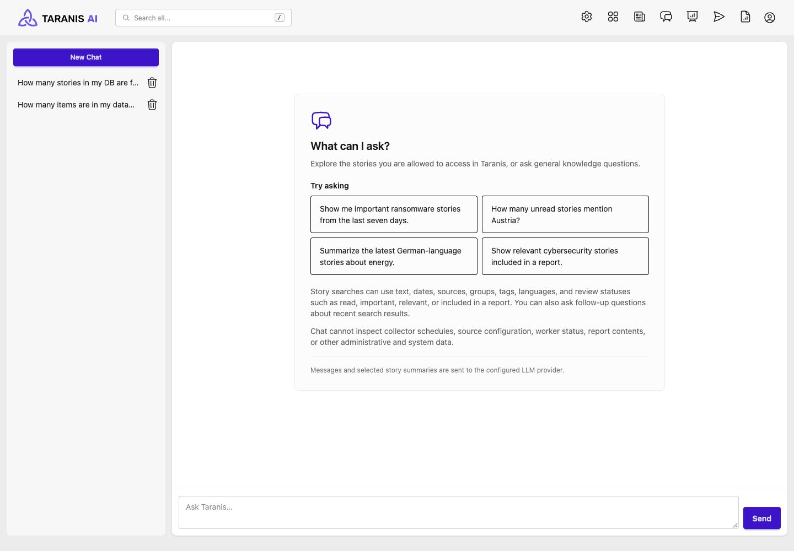
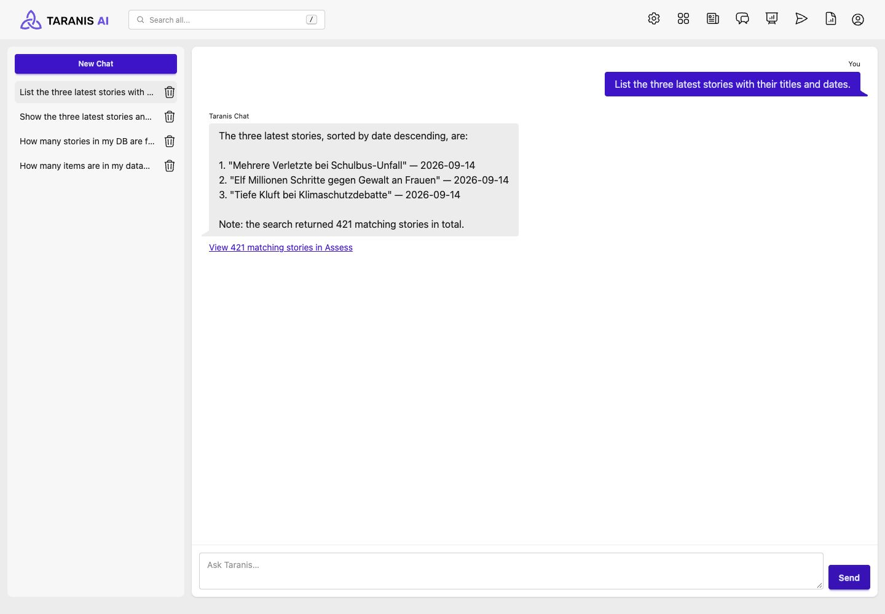

Chat is an optional analyst workspace for exploring Stories in natural language. Ask for matching Stories, counts, or summaries, then open the results in [Assess](../assess/_index.md) to review the underlying material. You can also ask general knowledge questions.

Chat must be [enabled and configured by an administrator](../admin/chat.md). Analysts need the `ASSESS_ACCESS` permission. Story searches respect the same source access controls and TLP restrictions as Assess.

## Start a conversation

1. Select **Chat** in the top navigation.
2. Choose **New Chat** to start a separate conversation.
3. Type a question and select **Send**, or press **Enter**. Use **Shift+Enter** for a new line. Messages can contain up to 4,000 characters.
4. Alternatively, select a starter prompt under **Try asking**. Selecting a prompt sends it immediately.

If you see **Chat is not configured yet**, ask an administrator to complete **Admin Settings > Chat** before sending a message.

## What to ask

Describe the subject and any filters you need. For example:

- “Show me important ransomware stories from the last seven days.”
- “How many unread stories mention Austria?”
- “Summarize the latest German-language stories about energy.”
- “Show relevant cybersecurity stories included in a report.”

Story searches support text, dates, sources, source groups, tags, languages, read/unread state, importance, relevance, report membership, cybersecurity classification, and Stories changed by you. You can request an order such as newest first. Relative dates use your [profile timezone](../settings/_index.md); specify dates when you need a precise period.

Follow up in the same conversation to refine a search or ask about a recent result, such as “Tell me more about the second result.” Up to the latest 10 saved messages are included as conversation context, so restate older details when needed.

Chat can filter Stories by whether they are included in a Report, but it cannot inspect Report contents, collector schedules, source configuration, worker status, or other administrative and system data. Use the corresponding application pages for those tasks.

## Review answers in Assess

For a Story search, Chat searches the accessible collection and uses a limited number of Story summaries to compose its answer. The default is **5 Stories per answer**, configurable by an administrator from 1 to 20. A count of matching Stories can therefore be larger than the number summarized.

Select **View N matching stories in Assess** below a search answer to open the generated filters and inspect the results. This opens the current matching collection; its count can change as Stories or permissions change. Review the filters and original Stories before relying on an answer, especially when summaries contain too little detail to answer the question.

The example lists three recent Stories while the Assess link opens the full matching collection. If the selected Stories have no summary text, Chat can still list their titles and dates, but it may be unable to summarize their content.

General knowledge answers do not have an Assess results link. If a Story search finds no matches, Chat reports that outcome; try broader wording, a longer date range, or fewer filters.

When live updates are available, progress moves through **Planning…**, **Searching stories…** for searches, and **Writing answer…**. Chat still returns the completed answer when live updates are unavailable. Wait for the current response before sending another message in the same conversation.

## Conversation history and privacy

Successful conversations appear in the left sidebar, titled from the first message and ordered by recent activity. Select one to reopen it. Conversations are private to their owner within the application and persist until deleted. Use the trash button beside a conversation and confirm **Delete this chat conversation?** to remove it and its messages.

Your messages, recent conversation context, accessible filter information, and selected Story summaries are sent to the configured LLM provider. Check your organization's provider and data-handling policy before entering sensitive information. Deleting a conversation in Taranis does not control the provider's retention. See [provider privacy and storage](../admin/chat.md#privacy-and-storage).

## If a message fails

Failed turns do not save a partial question-and-answer pair. The message remains in the input so you can retry after the problem is resolved.

| Message or symptom | What to do |
| --- | --- |
| Chat is missing from navigation | Ask an administrator to check that Chat is enabled and your role has `ASSESS_ACCESS`. |
| **Chat is not configured yet** | Ask an administrator to configure the provider in **Admin Settings > Chat**. |
| **Another response is already being generated for this chat** | Let the existing response finish, including requests started in another tab. |
| **Chat provider timed out** or **Chat provider request failed** | Ask an administrator to check provider connectivity, API format, model, credentials, and timeout. |
| **Chat is temporarily unavailable** | Ask an administrator to check Redis availability. |

Deployment checks and proxy requirements are covered in [Chat deployment](../getting-started/09_chat.md).
