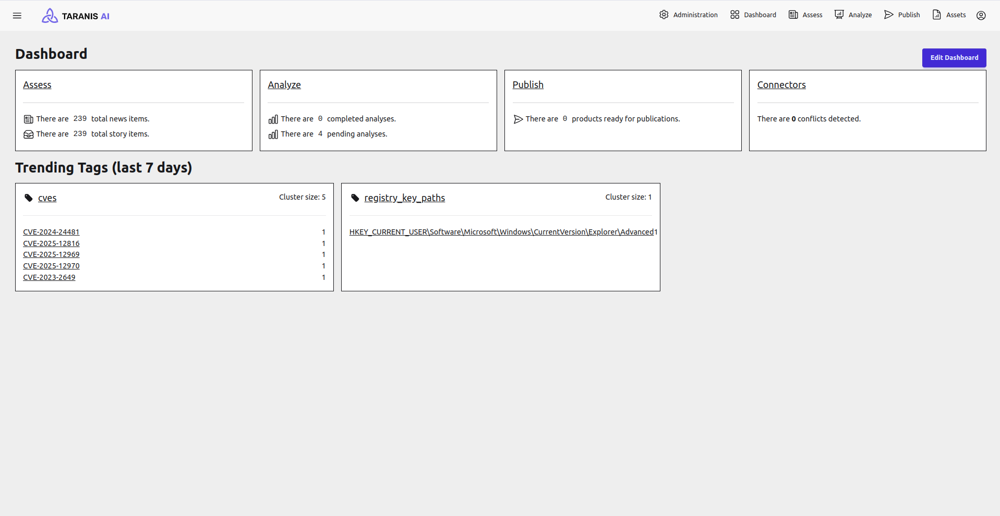

The Dashboard is the starting page after login. It brings together workflow statistics, recently active tags, and your saved Assess filters. Use it to check incoming information and choose a queue to work through.

## Workflow cards

Select a card's title to open the corresponding workspace.

| Card | What it shows | Where it leads |
| --- | --- | --- |
| **Assess** | Total News Items and Stories, plus News Items and Stories this week. | [Assess](../assess/_index.md) for reviewing collected information. |
| **Analyze** | Completed Reports, Reports in progress, and Reports created this week. | [Analyze](../analyze/_index.md) for preparing Reports. |
| **Publish** | Total Products and Products created this week. | [Publish](../publish/_index.md) for preparing and publishing Products. |
| **Connectors** | Pending conflicts, split into Story conflicts and News Item conflicts. | [Conflict resolution](conflict-resolution.md) for reviewing incoming changes. |

**This week** runs from Monday at 00:00 UTC through the current time. News Items are counted by publication date; Stories, Reports, and Products are counted by creation date. Future dates are excluded. For example, an older article collected today may increase the News Item total without increasing this week's News Item count.

These are instance-wide statistics. An Assess filter or a user's content permissions can produce a different count in the destination workspace. The Publish count includes all Products; it does not indicate how many have been published or are ready to publish. Dashboard statistics are cached for 30 seconds, so recent changes may take a short time to appear when reloading.

## Start analyst review

The **Start analyst review** button on the Assess card opens a guided workflow through Stories, a Report, and a Product.

1. Choose an incomplete Report, or create one with a title and Report Type.
2. Review a snapshot of the current shift's unread Stories, newest first. Configure **End of shift** in [User settings](../settings/_index.md) for shift filtering.
3. Use **Add** to attach a Story to the Report, mark it read, and clear its important flag. **Dismiss** marks it read and clears important without adding it. **Skip** advances without changing the Story. The corresponding keyboard shortcuts are `A`, `D`, and `S` when focus is outside editable controls.
4. After the queue, complete the Report if needed and continue to Publish. If exactly one existing Product contains the Report, that Product opens; otherwise, a new Product opens with the Report preselected. Review and publish the Product using the normal publishing controls.

The Story queue is fixed when the review starts; Stories arriving later belong to a subsequent review. The guided workflow does not publish automatically.

The button requires Assess access and update permissions, Analyze access/create/update permissions, and Publish access/create permissions. See [User management](../admin/user-management.md) if it is missing.

## Recently active tags

**Recently Active Tags** groups tags by type, such as Country or Location. Select an individual tag to open Assess with that tag filter, or select the card's heading to explore all tags of that type. The first three cards are visible initially; **Show more** reveals the rest.

The default activity window is seven days. A tag qualifies when it appears in a Story created within that window, but its displayed count includes matching Stories across all time. Each card lists up to five tags, ordered by their Story counts. **Total stories** sums those displayed tag counts, so a Story with several tags can contribute more than once.

See [Tags and Dashboard Settings](settings.md) for the tag table, map, activity window, and display options.

## Saved filters

Save recurring queues in Assess to make them available under **Saved Filters** on your Dashboard. For example, save unread important Stories, a language-specific queue, or a topic used during shift handover.

Select a saved filter's title to open that Assess queue. Cards show the filter URL and a **Default** badge when applicable. The first three are visible initially; **Show more** reveals additional filters. This section appears once you have saved a filter.

**Delete** removes the saved filter from your profile after confirmation, including its Assess shortcut. It does not delete Stories. Create or update filters and choose a default through the Assess **Saved filters** dialog. See [Filter Lists and Saved Filters](../assess/filter-lists.md).

## External signals

An optional **PizzINT / DOUGHCON** card displays an external signal under **External Signals**. It is disabled by default and can be enabled per user through **Edit Dashboard**. See [PizzINT / DOUGHCON](settings.md#pizzint--doughcon) for its fields and freshness indicators.

## Conflict resolution

Open **Connectors** to choose **Story Conflicts** or **News Item Conflicts**. The [Conflict Resolution guide](conflict-resolution.md) explains how to compare incoming MISP changes and choose a resolution.

## Administration

Users with administration privileges also have an [Admin Dashboard](administration.md) with queue information, release details, system health, and task outcomes.
