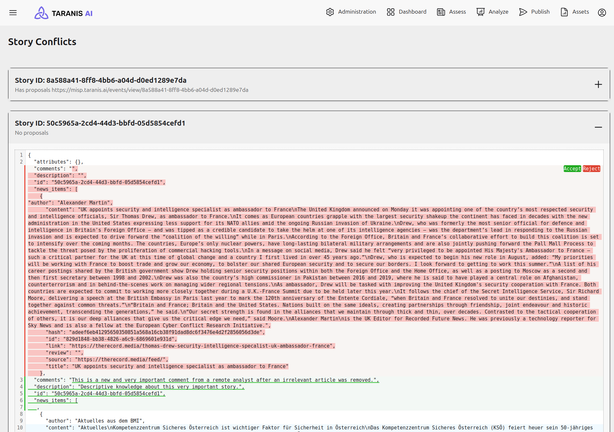
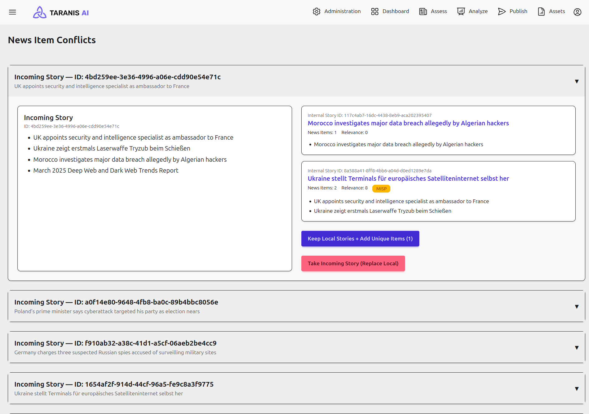

Conflict resolution is an experimental feature for reviewing incoming MISP changes that cannot be applied automatically because the local content has also changed.

Select **Connectors** from the Dashboard or Admin Dashboard to open **Conflict Overview**, then choose **Story Conflicts** or **News Item Conflicts**. Resolving conflicts requires Assess update permission. For connector setup and sharing, see [Connectors](../admin/connectors.md).

## Story conflicts

A Story conflict occurs when the same Story has changed both locally and in MISP, preventing a clean update.

Expand a Story's card to compare its existing and incoming content in the merge editor. Review the proposed changes, prepare the resolved content, and select **Submit Resolution**. The card also indicates whether MISP proposals are present.

The example below shows an incoming Story with a removed News Item and changes to comments and description.

## News Item conflicts

News Item conflicts occur when incoming and local Stories contain divergent News Items and local changes prevent an automatic update. Conflicts are grouped by incoming Story.

Expand a card to compare the incoming News Items with the existing local Stories. Local Story links open their details for inspection. Choose one of the following resolutions:

| Action | Result |
| --- | --- |
| **Keep Local Stories + Add Unique Items** | Keeps local Stories unchanged and ingests incoming News Items that are not already present separately. The button shows the number of unique items and is disabled if there are none or no local Stories remain. |
| **Take Incoming Story (Replace Local)** | Ungroups the affected local Stories and ingests the incoming Story as supplied. Review the local grouping and content before selecting this option. |

Conflicts are held in temporary memory. Run a fresh MISP collection before resolving them so the comparison reflects current incoming data; treat the conflict list as a working queue rather than a permanent history.
