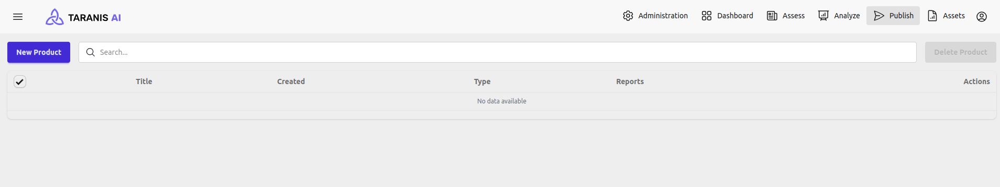

## Functionalities

Publish manages Products. A Product combines one or more Reports with a Product Type, renders the result into a file format, and sends the rendered file to a configured Publisher.

### Product setup

1. Select a Product Type.
2. Add supported Report Items.
3. Save the Product.
4. Render the Product.
5. Preview or download the rendered output.
6. Publish manually, or enable autopublish with a default Publisher.

Product Types define the renderer, template, output format, and which Report Types are compatible. See [Product Types](../admin/product-types.md).

### Render and preview

Rendering is a worker-backed action. HTML, JSON, text, and PDF Products can be previewed in the Product view after rendering. Other formats can be downloaded after rendering.

If workers are down, the render job can still be queued but will not complete until a worker starts. See [Background Jobs](../getting-started/07_background-jobs.md).

### Publishing

Manual publishing sends the rendered Product to a selected Publisher. Autopublish requires a default Publisher; when enabled, Taranis AI can automatically render and publish matching Products during report/product workflows.

Supported Publishers and their parameters are documented in [Publishers](../admin/publishers.md).

### Filter

* Search: Items can be filtered by string search
* Items per page: Number of items displayed per page
* Filter: Show items created today, this week, or this month

## Screenshot

> [!NOTE]
> See also [Product Types](../admin/product-types.md) and [Publishers](../admin/publishers.md).
