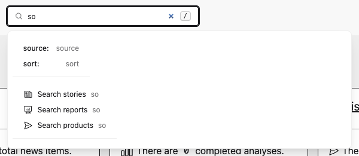

Omnisearch is the global search field in the top navigation. It is useful for quick lookup across the analyst workflow and for jumping directly into filtered list views.



## Scope search

An unqualified search shows grouped results for Stories, Reports, and Products. Use a scope prefix to search only one area and open its list view directly:

```text
story: ransomware
report: weekly
product: stix
```

Supported aliases:

| Scope | Aliases |
| --- | --- |
| Stories | `story:`, `stories:`, `assess:` |
| Reports | `report:`, `reports:`, `analyze:`, `analysis:` |
| Products | `product:`, `products:`, `publish:` |

`report:true` and `report:false` are reserved for Assess filtering. If you need to find a Report literally named `true` or `false`, use an unqualified global search.

## Assess filter syntax

Omnisearch can translate Assess-style filter tokens into the Assess sidebar query parameters. Tokens can be combined with free text:

```text
story: source:"CERT.at" tag:ransomware read:false important:true range:last7 sort:updated_desc
```

Supported Assess tokens:

| Token | Values |
| --- | --- |
| `source:` | Source name or source ID |
| `group:` | Source group name or group ID |
| `tag:` or `tags:` | Tag value |
| `read:` | `true`, `false` |
| `important:` | `true`, `false` |
| `relevant:` | `true`, `false` |
| `in-report:` or `report:` | `true`, `false` |
| `cybersecurity:` or `cyber:` | `yes`, `no`, `mixed`, `incomplete` |
| `changed-by:` | `me` |
| `range:` | `shift`, `24h`, `week`, `day`, `month`, `last7`, or `last<N>` |
| `from:` | Date or datetime value |
| `to:` | Date or datetime value |
| `sort:` | `date_desc`, `date_asc`, `relevance`, `updated_desc`, `updated_asc` |

Quote values that contain spaces. Omnisearch suggestions are loaded only when the query needs them, so normal global searches do not require loading every Assess filter list.

## Saved filters

Assess sidebar filters can be saved per user. One saved filter can be marked as the default, which makes `/assess` open that filtered queue automatically. Use `/assess?reset=true` to bypass the default and show the unfiltered list.

Saved filters also appear as dashboard shortcuts, so common queues such as "Unread important stories" can be opened without rebuilding the filter each time. See [Filter Lists and Saved Filters](../assess/filter-lists.md).
