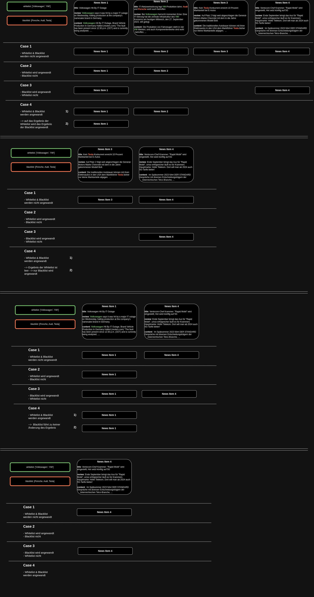

## Configure Sources
As an admin, I need to configure OSINT sources to be gathered for intelligence gathering purposes.

## Word Lists
As an admin, I need the ability to utilize Word Lists for filtering news items during collection or enhancing them with a Bot. This includes the capability to import and export word lists and apply them based on their designated usage, such as adding tags with the word_list_bot.

## Configure Report Types
As an admin, I need the ability to configure new report types.
## Configure Users
As an admin, I need to manage user accounts by creating and deleting users, ensuring they have the necessary access for their tasks.

## Configure ACLs and roles
As an admin, I need to configure Access Control Lists (ACLs) and roles to define permissions for each role. This allows me to effectively manage user permissions, control access to sensitive information, and maintain compliance with organizational policies and regulations.

